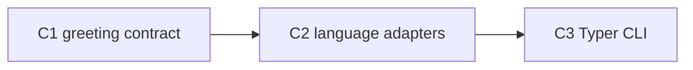

# hello suite: rollout

## Branches and isolation

- Loop branch: `feat/plans-hello`, created from `main` when the demo starts. Local only; the repo has no remote. The branch does not exist in the repo before the demo.
- Chapter branches: `feat/plans-hello-c1-contract`, `feat/plans-hello-c2-adapters`, `feat/plans-hello-c3-cli`.
- Each chapter runs in its own worktree under `.worktrees/` (gitignored).
- Integration: each completed chapter branch merges into the loop branch with `git merge --no-ff`, one at a time, in the order below.

## Dependency graph



## Chapter scheduling matrix

| ID | Chapter | depends_on | touches | Execution owner | Gate | Status |
| --- | --- | --- | --- | --- | --- | --- |
| C1 | `chapters/01-greeting-contract.md` | none | `pyproject.toml`, `uv.lock`, `src/hello/{__init__,contract,registry}.py`, `tests/test_contract.py` | chapter-implementer | paired tests, local CI, refactor outcome | pending |
| C2 | `chapters/02-language-adapters.md` | C1 | `src/hello/{adapters,registry}.py`, `tests/{test_adapters,test_registry}.py` | chapter-implementer | paired tests, local CI, refactor outcome | pending |
| C3 | `chapters/03-typer-cli.md` | C2 | `pyproject.toml`, `uv.lock`, `src/hello/cli.py`, `tests/test_cli.py`, `run.sh` | chapter-implementer | paired tests, local CI, `run.sh` demo | pending |
| G | final gate (`run.sh`, `uv build`, root `ci.sh`, tag) | C3 | none | chief-of-staff | exit codes, tag | pending |

## Parallel batches

1. `C1` alone.
2. `C2` alone. It depends on C1 and edits `registry.py`, which C1 creates.
3. `C3` alone. It depends on C2 and edits `pyproject.toml` and `uv.lock`, which C1 creates.

No batch holds more than one chapter. Every pair shares `pyproject.toml`, `uv.lock`, or `registry.py`, so the schedule is serial by design.

## Integration order

`C1` → `C2` → `C3`. Each merge is `git merge --no-ff` into `feat/plans-hello`.

## Critical path

`C1` → `C2` → `C3`. All three chapters lie on it, so no chapter can be parallelised away.

## Per-chapter gate

The chief accepts a chapter only when all of these hold:

1. The implementer reports the branch, commit SHA, diff summary, the happy and negative test results, and the refactor outcome.
2. `git diff feat/plans-hello...<branch> --name-only` stays inside the chapter's `touches`.
3. The narrow test command passes in the worktree, then the local CI command passes.
4. The merge is `--no-ff`, and the ledger records the merge commit.

Local CI command, run from `04-plan-suite/`:

```sh
uv sync && uv run ruff check . && uv run ruff format --check . && uv run mypy && uv run pytest && uv build
```

## Final gate (chief-of-staff)

After C3 is merged: run `04-plan-suite/run.sh`, run `./ci.sh` at the repo root, then tag `level-04-plan-suite`. The chief runs this gate itself; no implementer does.
